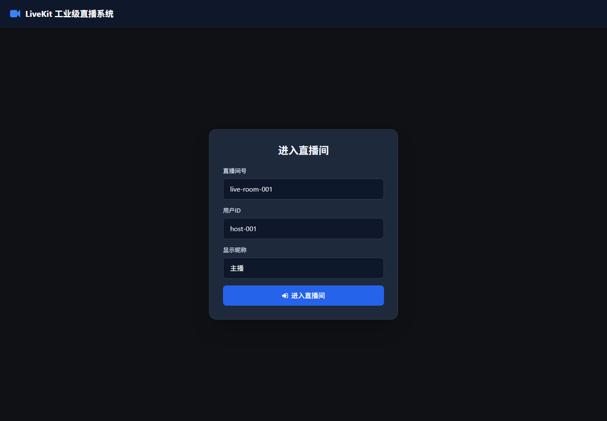

# LiveKit 直播系统 · Live Demo

> Go 后端 + LiveKit + 原生前端的多人直播/连麦示例：进入房间、发布/订阅音视频、成员列表、聊天与屏幕共享。适合作为 WebRTC / 实时音视频入门项目。


---

## 界面



---

## 功能

- 输入直播间号 / 用户ID / 昵称进入
- LiveKit Token 签发（Go 后端）
- 多人音视频发布/订阅
- 成员列表、麦克风/摄像头开关
- 屏幕共享
- 实时聊天（LiveKit Data Channel）
- 健康检查 `/health`
- Docker Compose 一键启动 LiveKit + Redis

---

## 技术栈

| 模块 | 技术 |
|---|---|
| 后端 | Go、LiveKit Server SDK、JWT |
| 音视频 | LiveKit v1.6、WebRTC |
| 前端 | 原生 HTML/CSS/JS、LiveKit Client SDK、Tailwind CDN |
| 编排 | Docker Compose（LiveKit + Redis） |

---

## 快速开始

### 1. 启动 LiveKit + Redis

```bash
docker compose up -d
# LiveKit: ws://localhost:7880
```

生产环境请使用正式 API Key/Secret，不要使用示例值。

### 2. 启动 Go 后端

```bash
cd backend
go mod download
go run .
# http://localhost:6060
```

通过环境变量覆盖密钥：

```bash
# Windows PowerShell
$env:LIVEKIT_API_KEY="your-key"
$env:LIVEKIT_API_SECRET="your-secret"
# macOS/Linux
export LIVEKIT_API_KEY=your-key
export LIVEKIT_API_SECRET=your-secret
```

### 3. 打开前端

```bash
cd frontend
python -m http.server 8080
# http://localhost:8080
```

输入房间号/用户ID/昵称 → 进入直播间。

---

## API

| 接口 | 方法 | 说明 |
|---|---|---|
| `/health` | GET | 健康检查 |
| `/api/token?room=&identity=&name=` | GET | 签发 LiveKit Token |

---

## 测试与验收

```bash
# Go 语法/构建（需安装 Go）
cd backend
go build ./...

# 前端静态检查
node --check frontend/index.html 2>/dev/null || true
```

手工验收：

- [ ] `docker compose up -d` 后 LiveKit/Redis 正常
- [ ] Go 后端 `/health` 返回 200
- [ ] 两个浏览器窗口进入同一房间，能互相看到/听到
- [ ] 麦克风/摄像头开关、屏幕共享
- [ ] 聊天消息实时到达

---

## 安全说明

- 示例 Key/Secret 仅用于本地开发；生产必须替换并通过环境变量/密钥管理注入。
- 生产环境需加鉴权、房间权限、TURN/TLS、限流与日志审计。
- 浏览器端需要 HTTPS 或 localhost 才能使用摄像头/麦克风。

---

## License

MIT License，详见 [LICENSE](LICENSE)。
